# Diagrama de arquitectura

Vista lógica del sistema Lab Modernización, basada en la configuración y el código del proyecto.

```mermaid
flowchart LR
    user["Usuario"]
    browser["Navegador"]

    subgraph frontend["Frontend - osi-front"]
        spa["Aplicación web Angular"]
        interceptor["Interceptor HTTP<br/>JWT y renovación ante 401"]
    end

    subgraph backend["Backend - osi-back"]
        api["API REST<br/>Spring Boot / Java 17<br/>Puerto 8091"]
        security["Spring Security<br/>JWT y permisos por rol"]
        controllers["Controllers<br/>Auth, usuarios, aplicaciones,<br/>requerimientos, tablero"]
        services["Servicios de negocio"]
        repositories["Repositorios Spring Data JPA"]
        openapi["OpenAPI / Swagger UI"]
        storage["Almacenamiento de adjuntos<br/>STORAGE_DIR"]
    end

    subgraph data["Persistencia"]
        oracle[("Oracle<br/>Esquema APRENDIZAJE")]
    end

    user --> browser
    browser --> spa
    spa --> interceptor
    interceptor -->|"HTTPS/HTTP: JSON REST bajo /api<br/>Authorization: Bearer JWT"| api
    browser -.->|"Cookie HttpOnly refresh_token<br/>solo en rutas /api/auth"| api
    api --> security
    security --> controllers
    controllers --> services
    services --> repositories
    repositories -->|"JPA / Hibernate"| oracle
    services -->|"Guardar y recuperar adjuntos"| storage
    api -.-> openapi
    openapi -.->|"Swagger UI /swagger-ui.html<br/>OpenAPI /v3/api-docs"| browser
```

## Flujo principal

1. Angular entrega las operaciones al backend bajo `/api` (en desarrollo, el proxy de Angular las dirige a `http://localhost:8091`).
2. El backend autentica las solicitudes protegidas mediante el access token JWT y verifica los permisos del usuario.
3. Los controllers delegan las reglas de negocio a servicios; los repositorios acceden a Oracle.
4. Los archivos adjuntos se guardan en el directorio del servidor configurado con `STORAGE_DIR`; la base de datos conserva sus metadatos y ruta relativa.
5. El refresh token viaja en una cookie HttpOnly y el backend conserva su hash en Oracle mediante los repositorios. El access token se mantiene en memoria en el frontend.

La ubicación real de almacenamiento y las credenciales de base de datos dependen del entorno; el diagrama no representa servidores físicos ni redes de producción.
