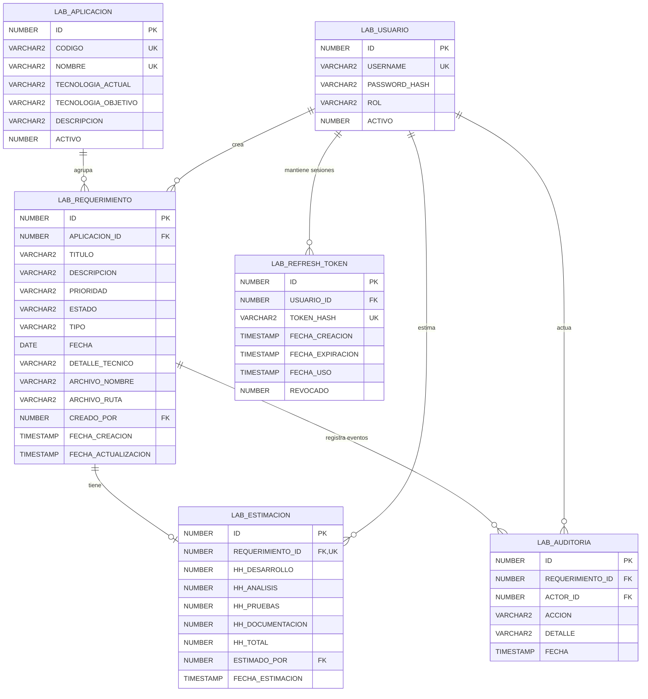

# Diagrama entidad-relación

Entidades y relaciones persistidas en Oracle, esquema `APRENDIZAJE`. Los permisos se derivan de los roles en el código y no son tablas independientes.

## Notas

- `PK` es clave primaria, `FK` es clave foránea y `UK` es una restricción única. `REQUERIMIENTO_ID` en `LAB_ESTIMACION` tiene ambas marcas: un requerimiento tiene cero o una estimación.
- `LAB_APLICACION.NOMBRE` tiene un índice único sobre `UPPER(NOMBRE)`, por lo que no se permiten nombres duplicados ignorando mayúsculas y minúsculas.
- Prioridad del requerimiento: `BAJA`, `MEDIA` o `ALTA`. Estado: `REGISTRADO`, `ESTIMADO`, `APROBADO` o `RECHAZADO`. Rol del usuario: `ANALISTA`, `COORDINADOR` o `APROBADOR`.
- `TOKEN_HASH` contiene el hash SHA-256 del refresh token, no el valor original entregado al navegador.
- Los tipos se muestran de forma resumida; consulta los scripts SQL para tamaños, precisión y restricciones completas.
